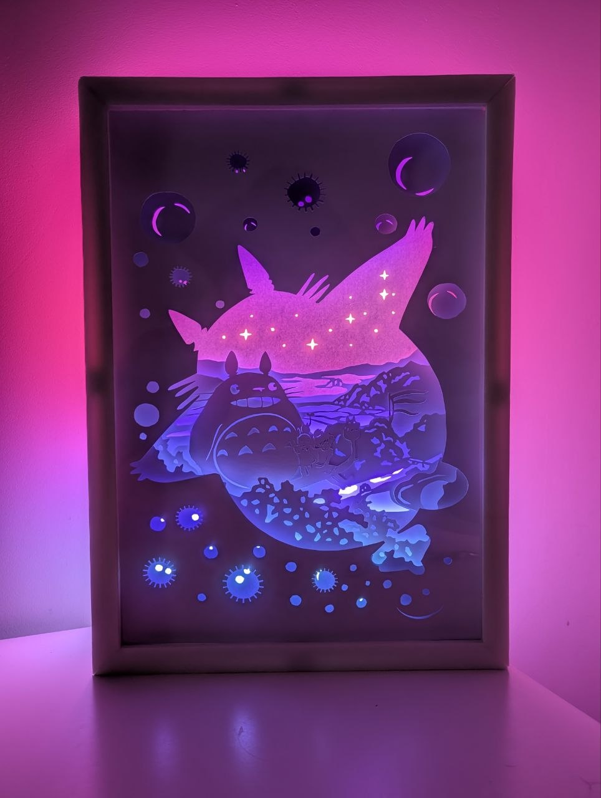
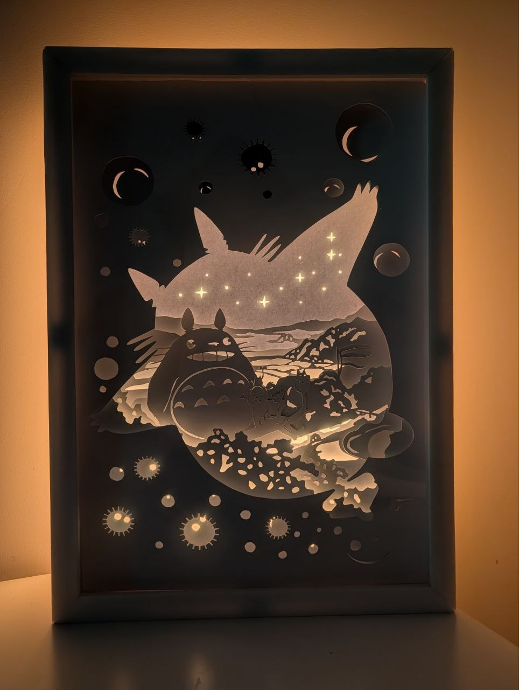
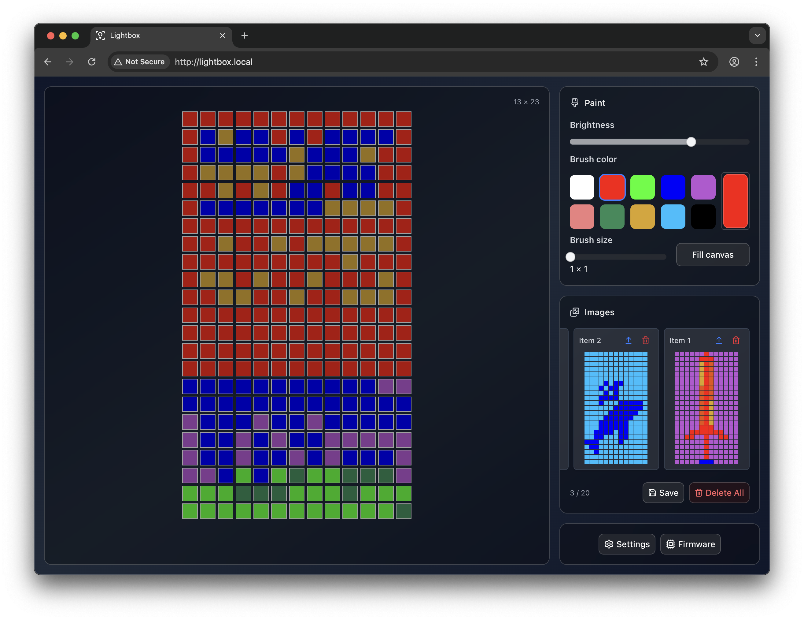
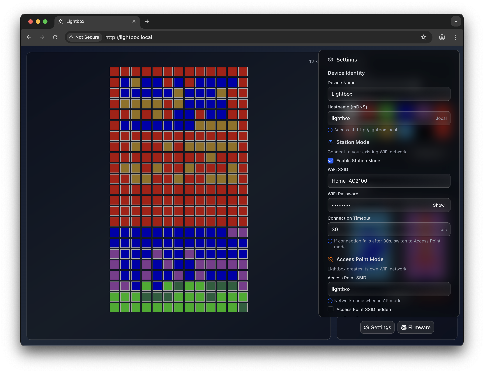

# Lightbox

This is my small ESP32 project that powers a paper-cut lightbox.

|                                                  |                                                |
| ------------------------------------------------ | ---------------------------------------------- |
|  |  |

## How it works

An ESP32 controls a WS2812B LED strip laid out as a 13x23 matrix.

The device runs a small web server with an http api and a bundled webui. On devices that
support mDNS the UI is available at <http://lightbox.local>.

wi-fi works in two modes: **Access point**: for initial configuration,
the device starts its own wi-fi network (`lightbox`/`12345678`).
**Station**: the device joins your home network and turns access point off.
If it can't connect to your home network, it switches back to access point mode.

The device remembers the last LED matrix state across reboots and can store up to 20
pictures in a gallery. Everything is controlled from the webui including firmware updates
over the air.

| Main page                                | Settings                                          |
| ---------------------------------------- | ------------------------------------------------- |
|  |  |

## Hardware

Parts that I used for an A3-size lightbox:

1. WS2812B ECO LED strip, 60 LEDs/m, 5 m (300 LEDs)
2. USB type-c PD trigger board
3. 2 MINI560 DC-DC buck converters (12–20 V to 5 V), one for the esp32 and one for the LED strip
4. esp32 with at least 4 MB of flash
5. 3 foam boards, 500 × 700 mm, for the case
6. Paper cutting mat and scalpel

The picture is cut from a [Totoro Lightbox](https://www.printables.com/model/580667-totoro-lightbox) model.
The seven print-ready layers are in [assets/totoro.tar](assets/totoro.tar).

## Installation

Requirements:

- [esp-idf](https://docs.espressif.com/projects/esp-idf/en/stable/esp32/get-started/index.html)
- [node.js](https://nodejs.org/) and npm, to build the web UI.

### 1. Build the web UI

The firmware embeds the compressed web UI from `lightbox-ui/dist`, so we need to build it first:

```bash
cd lightbox-ui
npm ci
npm run build
cd ..
```

### 2. Configure

```bash
idf.py set-target esp32
idf.py menuconfig
```

Under "App Configuration" you can set wi-fi password, led control GPIO, mDNS name etc.

Some of the settings can also be changed later from the web UI. Settings saved from the UI
take override these defaults.

### 3. Build and flash

Connect the ESP32 over usb and run:

```bash
idf.py build flash monitor
```

Press `Ctrl+]` to leave the serial monitor.

### 4. Connect

1. Join the `lightbox` network
2. Open <http://lightbox.local>
3. Enter your home wi-fi network in "Settings" and save

### Updating the firmware

After the first flash over USB, you can update over wi-fi: run `idf.py build`
and upload `build/lightbox.bin` in the web UI's firmware panel.
